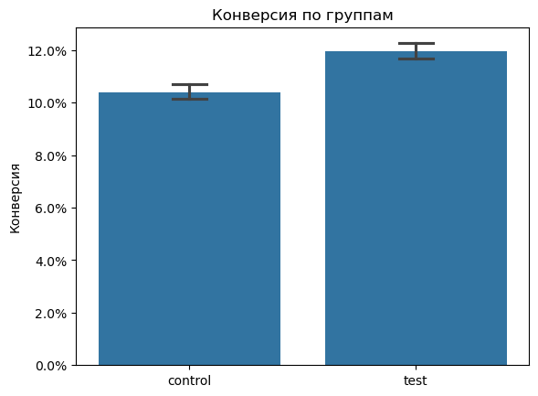
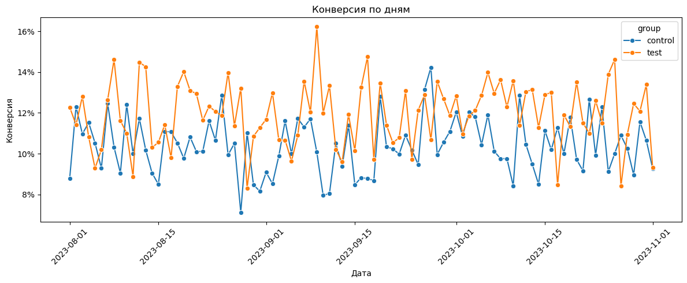

# Анализ A/B-теста страницы дебетовой карты

Анализ эксперимента с новым сообщением о кешбэке на странице дебетовой карты.
В проекте проверяется качество данных, сравниваются конверсии двух групп и
принимается решение по результатам теста.

Делал как учебный разбор эксперимента для практики по продуктовой аналитике.

## Разбор и вывод

В ноутбуке выполнена проверка качества данных эксперимента, сравнение размеров
групп и периода наблюдения, расчет конверсий, построение 95%-го доверительного
интервала, проверка различий критерием хи-квадрат и анализ конверсии по дням.
Конверсия контрольной группы составила 10,40%, тестовой - 11,96%. Абсолютный
рост равен 1,56 процентного пункта, относительный - 15,0%. Различие
статистически значимо (`p < 0,001`), поэтому результат поддерживает запуск
тестовой версии.

## Графики

Сравнение конверсий контрольной и тестовой групп с 95%-ми доверительными интервалами:

Динамика конверсии по дням эксперимента:

## Технологии

Python, pandas, NumPy, SciPy, Matplotlib, Seaborn и Jupyter.
